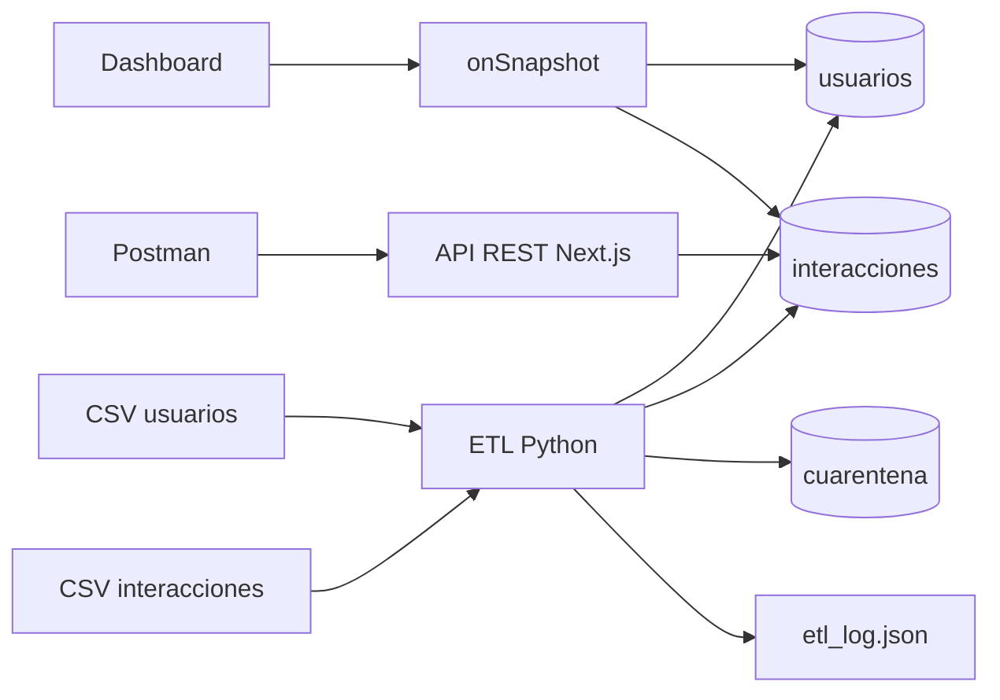

# COMMUNITY 360: Arquitectura de datos en la nube y dashboard analítico en tiempo real

Documento técnico de la Fase 1. Análisis, elección sustentada y modelado de datos.

## 1. Portada

| Dato | Contenido |
| --- | --- |
| Universidad | Universidad Tecnológica Metropolitana (UTM) |
| Carrera | Ingeniería en Desarrollo de Software Multiplataforma |
| Asignatura | Bases de Datos en la Nube |
| Unidad temática | Unidad III. Persistencia en la nube, arquitectura de datos y consumo reactivo |
| Título del proyecto | COMMUNITY 360: Arquitectura de datos en la nube y dashboard analítico en tiempo real |
| Alumno | Saulo Gregorio Irigoyen de la Cruz |
| Fecha de entrega | 19 de noviembre de 2026 |
| Modalidad | Individual |
| Entregable | Fase 1. Análisis exploratorio, comparativa SQL / NoSQL, elección de arquitectura, modelo documental y diccionario de datos |

<div style="page-break-after: always;"></div>

## 2. Análisis exploratorio de los archivos CSV

### 2.1 Alcance y método de conteo

La comunidad está partida en dos exportaciones:

- `comunidad_virtual_usuarios.csv`: padrón de miembros.
- `comunidad_virtual_1000_interacciones.csv`: muestra de eventos recientes. El enunciado nombra este archivo como `comunidad_virtual_interacciones_1000.csv`; el análisis usa el nombre real del archivo recibido.

Cada cifra de este apartado sale de un conteo sobre esas dos exportaciones. El script `scripts/verificar_estadisticas_fase1.py` vuelve a leer los CSV y falla si un total de este documento no coincide. Una celda vacía cuenta como nulo. Los decimales se escriben con punto, igual que en la fuente. Las medias y las medianas quedan redondeadas a seis decimales dentro del script.

No se imputa ningún valor en esta fase. La imputación permitida es una sola: anular geografía cuando `consentimiento_datos` vale `no`, y eso ocurre en la carga, no en el diagnóstico.

### 2.2 Estructura del padrón de usuarios

El padrón tiene 1068 filas y 22 columnas. Hay 1068 filas distintas, 1068 valores distintos de `id_usuario` y 1068 alias distintos. Los identificadores van de `U000001` a `U001068`, los 1068 cumplen el patrón `U` más seis dígitos y forman una secuencia contigua desde 1. No hay filas repetidas ni huecos en el folio.

El tipo de la derecha es el tipo observado en el archivo, antes de la conversión a Firestore.

| Atributo | Tipo en el CSV | Vacíos |
| --- | --- | ---: |
| id_usuario | cadena, patrón `U` + 6 dígitos | 0 |
| alias | cadena | 0 |
| fecha_ingreso | fecha `DD/MM/AAAA` | 0 |
| pais | cadena categórica | 0 |
| estado | cadena categórica | 0 |
| ciudad | cadena categórica | 0 |
| latitud | decimal, grados | 275 |
| longitud | decimal, grados | 275 |
| zona_horaria | cadena IANA | 0 |
| rango_edad | cadena categórica | 0 |
| especie_fursona | cadena categórica | 0 |
| interes_principal | cadena categórica | 0 |
| plataforma_principal | cadena categórica | 0 |
| es_artista | entero 0/1 | 0 |
| mensajes_30d | entero | 0 |
| reacciones_30d | entero | 0 |
| eventos_asistidos | entero | 0 |
| comisiones_compradas | entero | 0 |
| sentimiento_promedio | decimal | 0 |
| ultima_actividad | fecha `DD/MM/AAAA` | 0 |
| estatus | cadena categórica | 0 |
| consentimiento_datos | cadena `si` / `no` | 0 |

Las únicas columnas con vacíos son `latitud` y `longitud`, 275 cada una. En las 1068 filas las dos coordenadas vienen juntas: hay 0 registros con una sola de las dos. `fecha_ingreso` cubre del 01/01/2022 al 08/11/2026, con 0 fechas inválidas. `ultima_actividad` cubre del 09/10/2025 al 09/11/2026, con 0 fechas inválidas. `consentimiento_datos` solo toma `si` (897) y `no` (171); hay 0 valores fuera de ese par.

`estado` y `ciudad` son intercambiables en este padrón: hay 21 estados, 21 ciudades y 21 pares. Cada estado tiene una sola ciudad y cada ciudad tiene un solo estado. La dependencia importa para la privacidad: conservar el estado conserva la ciudad.

| Estado | Ciudad | Usuarios |
| --- | --- | ---: |
| CDMX | Ciudad de México | 200 |
| Yucatán | Mérida | 158 |
| Jalisco | Guadalajara | 96 |
| Nuevo León | Monterrey | 91 |
| Quintana Roo | Cancún | 61 |
| Querétaro | Querétaro | 51 |
| Puebla | Puebla | 44 |
| Tabasco | Villahermosa | 41 |
| Baja California | Tijuana | 39 |
| Buenos Aires | Buenos Aires | 36 |
| Cundinamarca | Bogotá | 35 |
| Guanajuato | León | 35 |
| Campeche | Campeche | 34 |
| California | Los Ángeles | 23 |
| Oaxaca | Oaxaca | 23 |
| Lima | Lima | 22 |
| Veracruz | Veracruz | 20 |
| Región Metropolitana | Santiago | 20 |
| Comunidad de Madrid | Madrid | 16 |
| Chihuahua | Chihuahua | 12 |
| Texas | Houston | 11 |

| País | Usuarios |
| --- | ---: |
| México | 905 |
| Argentina | 36 |
| Colombia | 35 |
| Estados Unidos | 34 |
| Perú | 22 |
| Chile | 20 |
| España | 16 |

Hay 13 zonas horarias. Cada estado cae en una sola zona. De las 13 zonas, 11 determinan un único estado y, en esas 11, el conteo de la zona es igual al conteo de su estado. Las otras dos agrupan varios estados: `America/Mexico_City` cubre 8 (CDMX, Guanajuato, Jalisco, Oaxaca, Puebla, Querétaro, Tabasco y Veracruz) y `America/Merida` cubre 2 (Campeche y Yucatán).

| Zona horaria | Usuarios |
| --- | ---: |
| America/Mexico_City | 510 |
| America/Merida | 192 |
| America/Monterrey | 91 |
| America/Cancun | 61 |
| America/Tijuana | 39 |
| America/Argentina/Buenos_Aires | 36 |
| America/Bogota | 35 |
| America/Los_Angeles | 23 |
| America/Lima | 22 |
| America/Santiago | 20 |
| Europe/Madrid | 16 |
| America/Chihuahua | 12 |
| America/Chicago | 11 |

| Rango de edad | Usuarios |
| --- | ---: |
| 18-24 | 534 |
| 25-31 | 328 |
| 32-38 | 133 |
| 39+ | 73 |

| Especie de fursona | Usuarios |
| --- | ---: |
| Zorro | 154 |
| Perro | 143 |
| Lobo | 141 |
| Gato | 115 |
| Híbrido/Otro | 103 |
| Dragón | 81 |
| Husky | 76 |
| Coyote | 69 |
| Conejo | 62 |
| Reptil | 45 |
| Ave | 41 |
| Tigre | 38 |

| Interés principal | Usuarios |
| --- | ---: |
| Arte digital | 211 |
| Videojuegos | 162 |
| Convenciones | 105 |
| Streaming/Contenido | 102 |
| Arte tradicional | 95 |
| Cómics | 93 |
| Fursuit | 91 |
| Música | 79 |
| Escritura/Historias | 76 |
| Cosplay | 54 |

| Plataforma principal | Usuarios |
| --- | ---: |
| Telegram | 333 |
| Facebook | 240 |
| TikTok | 159 |
| Instagram | 144 |
| Twitter/X | 102 |
| Discord | 90 |

| es_artista | Usuarios |
| --- | ---: |
| 0 | 780 |
| 1 | 288 |

| Estatus | Usuarios |
| --- | ---: |
| en_riesgo | 421 |
| activo | 390 |
| inactivo | 257 |

La actividad reciente está sesgada. La mediana de mensajes en 30 días es 3 y el máximo es 817; la mediana de reacciones es 7 y el máximo es 2026. Un promedio suelto describe mal a este padrón. El tablero tendrá que mostrar mediana o corte por estatus junto con el promedio.

| Atributo | N | Mínimo | Máximo | Media | Mediana |
| --- | ---: | ---: | ---: | ---: | ---: |
| mensajes_30d | 1068 | 0 | 817 | 7.832397 | 3 |
| reacciones_30d | 1068 | 0 | 2026 | 19.962547 | 7 |
| eventos_asistidos | 1068 | 0 | 8 | 0.464419 | 0 |
| comisiones_compradas | 1068 | 0 | 5 | 0.691948 | 0 |
| sentimiento_promedio | 1068 | -0.768 | 1 | 0.255006 | 0.254 |
| latitud | 793 | -34.6781 | 40.4919 | 18.101831 | 20.638 |
| longitud | 793 | -118.3149 | -3.6508 | -93.604957 | -99.0733 |

`interes_principal` es un solo valor por persona. En las 22 columnas del padrón hay 0 columnas con el separador `|`. El enunciado pide vigilar intereses multivaluados; en esta exportación el interés no lo es.

`plataforma_principal` describe al miembro. El `canal` de una interacción describe el evento. Son atributos distintos y el modelo no los fusiona.

`id_usuario` es la identidad operativa. El alias también es único en este extracto, y aun así no se usa como llave: el alias es un nombre público y puede dejar de ser único en una carga posterior.

### 2.3 Estructura de las interacciones

El archivo de interacciones tiene 1000 filas y 16 columnas. Hay 1000 filas distintas y 1000 valores distintos de `id_interaccion`. Los 1000 identificadores cumplen el patrón `I` más siete dígitos. El par (`id_usuario`, `id_interaccion`) también tiene 1000 valores distintos. Hoy el excedente de duplicados es 0; la regla de la Fase 2 se conserva porque la siguiente exportación puede traer repetidos.

| Atributo | Tipo en el CSV | Vacíos |
| --- | --- | ---: |
| id_interaccion | cadena, patrón `I` + 7 dígitos | 0 |
| id_usuario | cadena | 0 |
| timestamp | instante UTC `AAAA-MM-DDThh:mm:ssZ` | 0 |
| canal | cadena categórica | 0 |
| tipo | cadena categórica | 0 |
| texto | cadena | 144 |
| tema | cadena categórica | 0 |
| sentimiento | decimal | 0 |
| idioma | cadena categórica | 0 |
| pais | cadena | 173 |
| estado | cadena | 173 |
| ciudad | cadena | 173 |
| dispositivo | cadena categórica | 0 |
| longitud_texto | entero | 0 |
| reacciones_recibidas | entero | 0 |
| etiquetas | cadena multivaluada, separador `\|` | 231 |

Los 1000 timestamps son válidos y caen entre `2026-10-10T01:56:26Z` y `2026-11-08T23:50:15Z`. El idioma es `es` en las 1000 filas. La geografía del evento es todo o nada: hay 173 filas con país, estado y ciudad vacíos a la vez, y 0 filas con una geografía parcial.

Las 144 celdas de `texto` vacío son de tipo `reaccion`, y ese tipo tiene exactamente 144 filas. El texto vacío es el formato de la reacción, no un defecto de carga. `longitud_texto` coincide con la longitud del texto exportado en 856 filas y difiere en 144. Esas 144 son las reacciones: el archivo informa una longitud y deja el texto en blanco. La carga conserva el entero reportado y persiste el texto como nulo. No recalcula la longitud a 0.

| Canal | Interacciones |
| --- | ---: |
| Telegram | 304 |
| Facebook | 225 |
| Instagram | 157 |
| TikTok | 137 |
| Twitter/X | 101 |
| Discord | 76 |

| Tipo | Interacciones |
| --- | ---: |
| mensaje | 449 |
| comentario | 251 |
| reaccion | 144 |
| respuesta_encuesta | 112 |
| rsvp_evento | 44 |

| Tema | Interacciones |
| --- | ---: |
| arte_comisiones | 211 |
| reglas_moderacion | 175 |
| eventos_convenciones | 155 |
| videojuegos | 135 |
| memes_humor | 104 |
| fursuits | 80 |
| seguridad_privacidad | 76 |
| musica | 64 |

| Dispositivo | Interacciones |
| --- | ---: |
| Android | 551 |
| iOS | 226 |
| Web | 135 |
| Escritorio | 88 |

| Atributo | N | Mínimo | Máximo | Media | Mediana |
| --- | ---: | ---: | ---: | ---: | ---: |
| longitud_texto | 1000 | 38 | 77 | 55.603 | 54 |
| reacciones_recibidas | 1000 | 0 | 19 | 2.575 | 2 |
| sentimiento | 1000 | -0.9 | 0.95 | 0.26355 | 0.415 |

### 2.4 Campos multivaluados

El único campo multivaluado de las dos exportaciones es `etiquetas`. En interacciones hay 1 columna con `|`, y es esa: 516 filas traen el separador. En el padrón hay 0.

La celda se parte por `|`, se recortan espacios y se descartan tokens vacíos. El resultado es un arreglo de 0 a 3 cadenas. El máximo observado es 3. El vocabulario observado tiene 7 etiquetas y 1524 ocurrencias.

| Etiquetas en la fila | Filas |
| --- | ---: |
| 0 | 231 |
| 1 | 253 |
| 2 | 277 |
| 3 | 239 |

Las 231 filas sin etiqueta son las celdas vacías. Las 769 restantes traen al menos una. Las 516 con separador son la suma de las filas con 2 etiquetas (277) y las filas con 3 (239).

| Etiqueta | Ocurrencias |
| --- | ---: |
| humor | 232 |
| evento | 229 |
| aviso | 228 |
| arte | 221 |
| musica | 208 |
| reglas | 206 |
| juegos | 200 |

La etiqueta no tiene atributos propios: no tiene fecha, autor ni peso. Siempre se lee junto con el evento que la porta. Por eso el modelo documental la embebe como arreglo y no abre una colección ni una tabla puente. Firestore puede filtrar ese arreglo con `array-contains`. Una fila vacía se guarda como arreglo vacío, así la consulta no distingue entre nulo y lista ausente.

`interes_principal` se queda como cadena cerrada de 10 valores. Si una exportación futura trae varios intereses en una celda, el cambio de modelo será pasar ese campo a arreglo con la misma regla de `etiquetas`. Hoy el dato no justifica ese cambio.

### 2.5 Vinculación por id_usuario

La única relación entre los dos archivos es `id_usuario`. No hay llave foránea física: el vínculo se comprueba al cruzar los conjuntos.

| Conjunto | Registros |
| --- | ---: |
| Interacciones cuyo `id_usuario` está en el padrón | 207 |
| de ellas, con consentimiento `si` | 181 |
| de ellas, con consentimiento `no` | 26 |
| Interacciones cuyo `id_usuario` no está en el padrón | 793 |
| `id_usuario` distintos citados en interacciones | 750 |
| de ellos, presentes en el padrón | 136 |
| de ellos, ausentes del padrón | 614 |
| Usuarios del padrón sin ninguna interacción en la muestra | 932 |

Los identificadores de usuario del padrón ocupan `U000001`–`U001068`. Las 793 interacciones sin padre citan folios fuera de ese rango. Un ejemplo verificable es `I0000410`, que apunta a `U005764`, y `U005764` no está en el padrón. Ese evento es el caso de uso de la colección `cuarentena`: se conserva entero, con el motivo `id_usuario_inexistente`, y no entra a los indicadores.

La cardinalidad observada, contando solo el cruce que sí resuelve, es de un usuario hacia cero o muchas interacciones. 932 usuarios quedan en cero. 136 usuarios concentran las 207 interacciones válidas. Del lado de la interacción, cada fila tiene exactamente un `id_usuario`, y ese identificador puede no existir.

Las 793 sin padre no se eliminan. El enunciado pide un conjunto de rechazados y una bitácora. El modelo les da la colección `cuarentena` y el archivo `etl_log.json`. Los indicadores del tablero leen `interacciones`, así que un rechazo no mueve un KPI. La pantalla de calidad, cuando exista, lee `cuarentena` aparte.

### 2.6 Consentimiento y geografía

`consentimiento_datos = no` aparece en 171 usuarios. La regla de negocio prohíbe persistir su información geográfica y nombra `ciudad`, `latitud`, `longitud` y cualquier dato que permita inferir la ubicación.

El archivo ya aplicó una parte de esa regla y dejó otra sin aplicar. En los 171, `latitud` y `longitud` vienen vacías. En los mismos 171, `ciudad`, `estado`, `pais` y `zona_horaria` vienen poblados. Hay además 104 usuarios con consentimiento `si` y coordenadas vacías. La coordenada en blanco no identifica al grupo sin consentimiento: el grupo se identifica solo por el campo `consentimiento_datos`.

| Campo | consentimiento = no (171) | consentimiento = si (897) |
| --- | ---: | ---: |
| ciudad poblada | 171 | 897 |
| latitud vacía | 171 | 104 |
| longitud vacía | 171 | 104 |
| latitud poblada | 0 | 793 |
| longitud poblada | 0 | 793 |
| una sola coordenada | 0 | 0 |
| estado poblado | 171 | 897 |
| pais poblado | 171 | 897 |
| zona_horaria poblada | 171 | 897 |

Anular únicamente la ciudad no cumple la regla. En este padrón el estado determina la ciudad (21 pares biunívocos). La zona horaria reconstruye el estado en 11 de 13 zonas, y en las dos restantes lo reduce a una región de 8 estados o de 2. El país localiza a nivel nacional. Los seis campos son geográficos o cuasi-identificadores geográficos en estos datos.

La carga, para cada usuario con `consentimiento_datos = no`, asigna nulo a:

- `pais`
- `estado`
- `ciudad`
- `latitud`
- `longitud`
- `zona_horaria`

Las claves siguen en el documento, con valor nulo, para que el esquema no cambie de un miembro a otro. El resto del perfil se conserva: alias, fechas, rango de edad, fursona, interés, plataforma, métricas, sentimiento, estatus y el propio consentimiento. El tablero puede contar a la persona en actividad y retención, y la excluye de mapas y cortes territoriales porque su geografía quedó nula.

La misma regla baja a las interacciones del usuario que no consiente: se anulan `pais`, `estado` y `ciudad` del evento. En el extracto actual esas 26 interacciones ya traen los tres campos vacíos, así que la transformación no cambia el valor y sí deja la regla escrita para la próxima exportación. Las 181 interacciones de usuarios que sí consienten traen la geografía completa.

Las 793 interacciones sin padre no tienen un consentimiento que consultar. Su geografía se conserva como llegó: 646 traen país, estado y ciudad, y 147 no traen ninguno. Si más adelante el folio se incorpora al padrón, la promoción de `cuarentena` a `interacciones` vuelve a evaluar el consentimiento antes de copiar la geografía.

### 2.7 Calidad observada y balance esperado de la carga

| Revisión | Resultado en este extracto |
| --- | --- |
| Filas de usuarios duplicadas completas | 0 |
| `id_usuario` repetido | 0 |
| Alias repetido | 0 |
| Fechas de usuario inválidas | 0 |
| `consentimiento_datos` fuera de `si` / `no` | 0 |
| Filas de interacciones duplicadas completas | 0 |
| `id_interaccion` repetido | 0 |
| Par (`id_usuario`, `id_interaccion`) repetido | 0 |
| Timestamps inválidos | 0 |
| Geografía parcial en interacciones | 0 |
| Enteros obligatorios vacíos | 0 |

Con esas mediciones, la primera carga correcta de estos dos archivos tiene que cerrar así. Los contadores son el oráculo de la bitácora de la Fase 2.

| Destino | Registros | Criterio |
| --- | ---: | --- |
| `usuarios` | 1068 | Todo el padrón. 171 documentos con los seis campos geográficos en nulo. |
| `interacciones` | 207 | `id_usuario` presente en el padrón depurado. Incluye 181 con geografía y 26 con geografía nula por consentimiento. |
| `cuarentena` | 793 | `id_usuario` ausente. Motivo `id_usuario_inexistente`. |
| Duplicados descartados | 0 | Hoy no hay excedentes. La regla sigue activa. |
| Rechazos por tipo inválido | 0 | Hoy todas las fechas, enteros y decimales obligatorios parsean. |

El usuario sin consentimiento se carga. No se manda a cuarentena. La cuarentena es para la referencia rota y, si apareciera, para el tipo inválido. Silenciar cualquiera de los dos violaría el enunciado.

### 2.8 Hallazgos que fija el modelo

1. Hay dos entidades planas y una referencia lógica. La referencia resuelve en 207 eventos y falla en 793.
2. El único grupo repetido real es `etiquetas`, con tope observado de 3 y vocabulario de 7. Se embebe.
3. La integridad que el problema exige es una política de carga con tres salidas: escribir en `usuarios` o `interacciones`, anonimizar geografía, o aislar en `cuarentena`.
4. La privacidad no está resuelta en el CSV. Falta anular ciudad, estado, país y zona horaria en los 171, y dejar explícito el nulo de las coordenadas que ya vienen vacías.
5. El tablero necesita el perfil entero y el evento entero en una lectura, y necesita enterarse del cambio sin recargar. Eso decide el apartado 4.

## 3. Comparativa técnica SQL vs. NoSQL

La comparación usa cuatro ejes pedidos por la materia y los aplica a los conteos del apartado 2. SQL significa aquí un relacional administrado en la nube (PostgreSQL o equivalente). NoSQL significa un almacén documental, que en este proyecto es Cloud Firestore. No se comparan los paradigmas en abstracto.

| Criterio | Relacional (SQL) | Documental (Firestore) | Peso en COMMUNITY 360 |
| --- | --- | --- | --- |
| Estructura | Esquema fijo, filas atómicas, tabla puente para repetir `etiquetas`. | Un documento por usuario y otro por evento. `etiquetas` viaja como arreglo de 0 a 3. | El padrón ya es plano. El único repetido no tiene vida propia. El arreglo evita 1524 filas hijas para un dato que se pinta con el evento. |
| Integridad | PK, UNIQUE y FK dentro del motor. La FK rechaza al hijo sin padre. | El motor no declara FK. Las reglas viven en la carga, en la API y en las reglas de seguridad. | Una FK rechazaría las 793 interacciones sin padre. El enunciado pide conservarlas en cuarentena. |
| Escalabilidad | Fuerte en agregación ad hoc y en transacciones sobre filas relacionadas. El volumen de esta entrega no lo estresa. | Fuerte en lecturas por documento y en muchos clientes escuchando cambios. Débil en un `GROUP BY` libre. | El volumen de hoy es 1068 + 1000. Lo que el producto multiplica es el número de tableros abiertos y las escrituras puntuales de la demostración. |
| Tiempo real | El `COMMIT` confirma la fila. Hace falta otro canal (poll, `LISTEN/NOTIFY` o un WebSocket propio) para avisar al tablero. | La escritura del documento es el evento que `onSnapshot` entrega a los clientes suscritos. | La Fase 5 exige ver el alta, el cambio y la baja sin recargar, y esas operaciones entran por la API, fuera del tablero. |

### 3.1 Estructura

Una tabla `usuarios` con 22 columnas representa el padrón sin pérdida: una fila, un miembro, un valor por atributo. En eso el relacional y el documental empatan. La diferencia aparece en `etiquetas` y en la referencia opcional.

`etiquetas` se partiría, en SQL, en una tabla `interaccion_etiqueta` con una fila por ocurrencia. Este archivo produciría 1524 filas hijas, con un máximo de 3 por evento y un vocabulario de 7 palabras que no tienen columnas propias. Cada tarjeta del tablero haría un join para reconstruir un arreglo que la exportación ya traía en una celda. En el documento, el arreglo se guarda y se lee con el texto, el tema y el timestamp. `array-contains` cubre el filtro por etiqueta que el tablero necesita.

La relación tampoco es un caso limpio de hijo obligatorio. 207 eventos tienen padre y 793 no. El modelo tiene que expresar las dos situaciones. Un documento de interacción con `id_usuario` en cadena expresa el vínculo cuando el padre existe. Una colección hermana expresa el evento cuando el padre no existe. Embeber los eventos dentro del usuario dejaría a las 793 sin documento padre donde vivir, y obligaría al tablero global a recorrer subcolecciones de 1068 miembros para pintar un feed de 207 eventos válidos.

### 3.2 Integridad

El relacional gana cuando la regla cabe en una declaración: identidad única, tipo, hijo que no puede nacer sin padre. En este extracto la identidad ya viene limpia (0 duplicados en `id_usuario`, en `id_interaccion` y en el par). Una FK añadiría un rechazo automático de las 793 filas sin padre. Ese rechazo es exactamente lo que el enunciado prohíbe hacer en silencio.

La otra regla de integridad es la privacidad, y tampoco es una FK. Depende del valor `consentimiento_datos` y reescribe seis campos del usuario y tres del evento. Es una transformación con bitácora. Se puede programar delante de un `INSERT` de SQL o delante de un `set` de Firestore, con el mismo resultado comprobable: 1068 usuarios cargados, 171 con geografía nula, 207 interacciones aceptadas, 793 en cuarentena, 0 duplicados, 0 tipos inválidos.

Por eso la integridad de COMMUNITY 360 se diseña como política de aplicación, con un solo escritor privilegiado. El ETL y la API usan el Admin SDK. El cliente del tablero autentica para leer y no recibe permiso de escritura sobre `usuarios`, `interacciones` ni `cuarentena`. La colección de cuarentena y `etl_log.json` son la evidencia de que la regla se aplicó. Un motor relacional seguiría necesitando ese programa para el consentimiento y para no perder a los huérfanos; la FK no sustituye ninguna de las dos reglas.

### 3.3 Escalabilidad

1068 perfiles y 1000 eventos caben en cualquier plan gratuito de una base administrada. Elegir motor por el tamaño de esta muestra sería ruido. El eje de crecimiento del sistema es el de la materia: varios navegadores con el tablero abierto y escrituras pequeñas que llegan por REST mientras el dashboard se actualiza.

Ese patrón favorece particionar por documento y empujar el cambio al listener. Firestore está construido alrededor de esa lectura. Las agregaciones del encargo son un catálogo cerrado y ya visible en el apartado 2: estatus, país cuando existe, rango de edad, interés, plataforma, canal, tipo, tema, dispositivo, etiqueta y sentimiento. La API las calcula sobre colecciones que hoy se leen completas. Si el historial crece por encima de una lectura cómoda, el paso siguiente es materializar esos conteos en un documento de métricas actualizado por la misma API. No es el modelo de esta fase, porque con 1000 eventos la lectura directa todavía es honesta y auditable.

El límite se reconoce aquí para no vender el documental como motor analítico. Una consulta nueva, no prevista, con varios cruces y un agrupado arbitrario, se escribe más directo en SQL. Este proyecto no pide ese explorador. Pide indicadores definidos, privacidad verificable y un tablero que reaccione.

### 3.4 Procesamiento en tiempo real

El flujo de demostración está fijo. Postman llama a la API, la API modifica una interacción y el tablero, que no tiene formularios de alta, edición ni baja, muestra el efecto sin recargar la página.

En SQL la transacción confirma la fila y el tablero se entera solo si otro componente le avisa. Ese componente puede ser un poll, un canal del propio Postgres o un servidor de WebSockets. Hay dos mecanismos y pueden separarse: la fila ya cambió y el socket no salió, o el socket salió y el cliente no coincide con la lectura siguiente.

En Firestore la API escribe el documento con el Admin SDK y los clientes suscritos con `onSnapshot` reciben esa escritura. La suscripción es el canal push que el enunciado describe como WebSocket: el navegador no pregunta en ciclo, el cambio llega. La API REST se mantiene para la consulta histórica, para el CRUD de la demostración y para devolver códigos HTTP. El tiempo real propaga el mismo documento que la API acaba de validar. Hay una fuente de verdad.

## 4. Elección sustentada de tecnología y arquitectura

### 4.1 Decisión

El proyecto adopta un modelo documental único en Cloud Firestore. La política de integridad queda en el ETL de Python y en la API de Next.js. El tiempo real queda en `onSnapshot`. Se descarta el relacional puro porque su integridad declarativa no expresa la cuarentena ni el consentimiento, y porque el tiempo real exigiría un segundo canal. Se descarta el híbrido por la razón del apartado 4.4.

La materia pide un servicio de nube que el alumno no haya usado antes. Firestore es el motor fijado para cumplir esa exploración y, sobre todo, el que encaja con las tres reglas medidas en los CSV: referencia opcional, anonimización condicional y propagación del cambio.

### 4.2 Stack y responsabilidad

| Capa | Tecnología | Responsabilidad |
| --- | --- | --- |
| Carga (Fase 2) | Python 3, Pandas, Firebase Admin SDK | Validar, deduplicar, anular geografía, partir aceptados y cuarentena, escribir `etl_log.json` y subir los documentos. |
| Persistencia | Cloud Firestore | Colecciones `usuarios`, `interacciones` y `cuarentena`. |
| Identidad | Firebase Authentication, correo y contraseña | Sesión de quien abre el tablero y de quien llama a la API. |
| API histórica y CRUD | Next.js App Router, Route Handlers en `/api` | Consultas y alta, cambio y baja de interacciones. Token Bearer. Códigos 200, 201, 400, 401, 404 y 500. |
| Tiempo real | `onSnapshot` en el cliente autenticado | Entregar altas, cambios y bajas al tablero. |
| Interfaz (fases posteriores) | Next.js, TypeScript, Tailwind CSS, Recharts o Chart.js | Tablero oscuro, de alto contraste, sin formularios de escritura sobre interacciones. |
| Secretos | `.env.local` | `NEXT_PUBLIC_FIREBASE_*` en el cliente. `FIREBASE_SERVICE_ACCOUNT_*` solo en servidor. Cero credenciales en el código. |

Firebase Authentication, las reglas de seguridad, el Admin SDK y los listeners pertenecen al mismo proyecto. Un documental equivalente, como MongoDB Atlas con change streams, también guardaría estos documentos. Obligaría a resolver aparte la sesión, el token de la API y el canal hacia el navegador. El encargo ya pide esas tres piezas; concentrarlas en Firebase evita dos servicios extra sin cambiar el modelo de datos.

### 4.3 Flujos



Carga inicial. El ETL lee los dos CSV, aplica el apartado 5.5 y escribe tres colecciones más la bitácora. Al terminar, los contadores tienen que coincidir con la tabla del apartado 2.7.

Consulta histórica. El tablero, ya autenticado, llama a la API. La API valida el Bearer de Firebase Auth, lee Firestore y responde JSON con el código que corresponda. Esas lecturas alimentan los indicadores que no dependen de un listener, y sirven como evidencia de la petición y de la respuesta.

Mutación en vivo. Postman envía el alta, el cambio o la baja a `/api/interacciones`. La API valida el token y el cuerpo. Sin token válido responde 401. Con un cuerpo mal formado, o con un `id_usuario` que no está en el padrón, responde 400 y no escribe el evento. Si el cambio o la baja apuntan a un `id_interaccion` ausente, responde 404. El alta aceptada responde 201 y el cambio o la baja aceptados responden 200. El listener recibe esa escritura y el tablero recalcula.

La cuarentena pertenece a la carga del CSV: ahí quedan las 793 referencias que ya ocurrieron y no tienen padre. Un alta nueva con folio inexistente se rechaza en la API y queda fuera de `interacciones` y de los indicadores. Un fallo no previsto responde 500.

### 4.4 Por qué un solo motor

Un híbrido con usuarios en SQL e interacciones en Firestore daría una FK a los 207 eventos que sí tienen padre. Los 793 seguirían necesitando una tabla o una colección de cuarentena, y el consentimiento seguiría siendo código: ninguna FK anula la ciudad cuando el permiso vale `no`. El tablero quedaría escuchando un motor y consultando el otro, o replicando perfiles hacia Firestore para poder pintar la ficha.

Con 1068 usuarios, esa réplica no compra una integridad distinta de la que el ETL ya puede garantizar en una escritura. El diseño se queda en un almacén, una bitácora y un escritor privilegiado.

### 4.5 Límites que el diseño acepta

Firestore no impone llaves foráneas. La compensación es el orden de reglas del apartado 5.5, la colección `cuarentena`, la bitácora y la prohibición de escritura desde el cliente.

Firestore no trae índice geoespacial. El mapa de la fase del tablero agrega por `estado` y `ciudad`, que en este padrón son 21 pares, y coloca marcadores solo para los 793 perfiles con coordenadas y consentimiento `si`. Los 171 no aportan punto. No se calcula un geohash en esta fase porque ninguna consulta del encargo pide radio ni distancia.

Un documento de Firestore tiene un tope de 1 MiB. Las interacciones van en su propia colección para respetarlo: el historial de un miembro activo no tiene tope de negocio, y embeberlo reescribiría el perfil en cada evento nuevo. El listener del feed recibiría el perfil completo por un mensaje de una línea.

Una consulta admite un solo `array-contains`. El modelo tiene un solo arreglo, `etiquetas`, así que el límite no recorta los filtros previstos.

## 5. Modelado formal de datos

### 5.1 Colecciones, embebidos y referencias

Tres colecciones de primer nivel:

| Colección | ID del documento | Papel |
| --- | --- | --- |
| `usuarios` | `id_usuario` | Padrón depurado. Un documento por miembro. |
| `interacciones` | `id_interaccion` | Eventos cuyo usuario existe en el padrón. Fuente de los KPI. |
| `cuarentena` | `id_interaccion` | Eventos conservados fuera de los KPI, con motivo. |

El identificador también se guarda dentro del documento. La ruta ya lo contiene; repetirlo deja el JSON de la API explicable sin mirar la ruta.

Embebido. `etiquetas` es un arreglo de cadenas dentro de la interacción y dentro de la cuarentena. Tope observado: 3. Sin atributos propios. Se lee siempre con el evento.

Referencia. `interacciones.id_usuario` apunta a `usuarios/{id_usuario}`. El perfil no se copia dentro del evento. Estatus, consentimiento y métricas de 30 días cambian en el usuario; copiarlos obligaría a reescribir todos sus eventos. El tablero resuelve la ficha con una segunda lectura por identificador, o con el listener de `usuarios` que ya tiene abierto.

No se usa subcolección `usuarios/{id}/interacciones`. Las 793 huérfanas no tendrían dónde colgar, el feed global se volvería una consulta de grupo de colecciones y la cuarentena quedaría fuera de esa jerarquía de todas formas.

`etl_log.json` es un archivo de la corrida, junto al script de carga. No es colección. Cabe en el diccionario porque es la entidad que hace reproducible la transformación.

### 5.2 Documento `usuarios`

Ejemplo real, ya convertido. `U000001` tiene `consentimiento_datos = si`, así que la geografía se conserva. Las fechas del CSV no traen hora; la carga las fija a las 00:00:00 UTC. `es_artista` pasa de `1`/`0` a booleano.

```json
{
  "id_usuario": "U000001",
  "alias": "PixelZac83",
  "fecha_ingreso": "2026-04-21T00:00:00Z",
  "pais": "México",
  "estado": "Yucatán",
  "ciudad": "Mérida",
  "latitud": 20.936,
  "longitud": -89.6843,
  "zona_horaria": "America/Merida",
  "rango_edad": "18-24",
  "especie_fursona": "Reptil",
  "interes_principal": "Arte digital",
  "plataforma_principal": "Facebook",
  "es_artista": true,
  "mensajes_30d": 4,
  "reacciones_30d": 13,
  "eventos_asistidos": 0,
  "comisiones_compradas": 0,
  "sentimiento_promedio": 0.394,
  "ultima_actividad": "2026-10-04T00:00:00Z",
  "estatus": "en_riesgo",
  "consentimiento_datos": "si"
}
```

Para los 171 documentos con `consentimiento_datos = no`, el mismo esquema queda con `pais`, `estado`, `ciudad`, `latitud`, `longitud` y `zona_horaria` en `null`. El ejemplo no reproduce el alias ni la ciudad de una persona de ese grupo: el apartado 2.6 ya midió que los seis campos vienen informados o, en el caso de las coordenadas, vacíos, y la carga los unifica en nulo.

### 5.3 Documento `interacciones`

Misma forma para los 207 eventos aceptados. `etiquetas` ya es arreglo. `texto` es nulo cuando el tipo es `reaccion`.

```json
{
  "id_interaccion": "I0001825",
  "id_usuario": "U000852",
  "timestamp": "2026-10-28T16:59:03Z",
  "canal": "Facebook",
  "tipo": "comentario",
  "texto": "¿Alguien conoce bandas locales de la región?",
  "tema": "musica",
  "sentimiento": 0.86,
  "idioma": "es",
  "pais": "México",
  "estado": "Yucatán",
  "ciudad": "Mérida",
  "dispositivo": "Android",
  "longitud_texto": 44,
  "reacciones_recibidas": 2,
  "etiquetas": []
}
```

`I0001825` está en el CSV con `etiquetas` vacías y con usuario `U000852`. Ese folio está en el padrón y su `consentimiento_datos` es `si`, así que la geografía se conserva. El evento ilustra un documento aceptado: arreglo vacío, texto presente y geografía presente.

Cuando el usuario existe y su consentimiento es `no`, `pais`, `estado` y `ciudad` se escriben en `null` aunque el CSV los traiga. En las 26 filas actuales ya llegan vacíos.

### 5.4 Documento `cuarentena`

Ejemplo real de referencia rota. `I0000410` cita a `U005764` y ese folio no está en el padrón. El texto vacío corresponde a una reacción. La geografía del CSV viene vacía y se guarda como nulo, sin aplicar una regla de consentimiento que no existe. `motivo_rechazo` y `fecha_cuarentena` no vienen en el CSV: los escribe la corrida. La fecha del ejemplo es la marca de una corrida, no un dato de origen.

```json
{
  "id_interaccion": "I0000410",
  "id_usuario": "U005764",
  "timestamp": "2026-10-31T06:31:24Z",
  "canal": "Instagram",
  "tipo": "reaccion",
  "texto": null,
  "tema": "reglas_moderacion",
  "sentimiento": -0.75,
  "idioma": "es",
  "pais": null,
  "estado": null,
  "ciudad": null,
  "dispositivo": "Android",
  "longitud_texto": 50,
  "reacciones_recibidas": 3,
  "etiquetas": ["arte"],
  "motivo_rechazo": "id_usuario_inexistente",
  "fecha_cuarentena": "2026-11-19T18:00:00Z"
}
```

Catálogo cerrado de `motivo_rechazo`:

| Motivo | Cuándo se usa | Esperado en esta carga |
| --- | --- | ---: |
| `id_usuario_inexistente` | El folio no está en `usuarios` después de depurar el padrón. | 793 |
| `tipo_invalido` | No parsea un obligatorio: identificador, timestamp, entero, decimal o categoría vacía. | 0 |

Un duplicado no entra a `cuarentena`. Se descarta, se conserva la primera copia y la bitácora incrementa el contador. El enunciado pide eliminar duplicados y, por separado, aislar referencias rotas.

### 5.5 Reglas de transformación

Orden de la carga de usuarios:

1. Leer la fila y validar tipos y dominios. Si falla, no se escribe el documento y la bitácora la marca inválida. Esperado hoy: 0.
2. Si `id_usuario` ya fue aceptado en la corrida o ya existe en `usuarios`, descartar la fila nueva y contarla como duplicado. Esperado hoy: 0. Se conserva la primera.
3. Convertir fechas `DD/MM/AAAA` a timestamp UTC de medianoche, `es_artista` a booleano y los enteros y decimales a número.
4. Si `consentimiento_datos` es `no`, poner en `null` los campos `pais`, `estado`, `ciudad`, `latitud`, `longitud` y `zona_horaria`.
5. Escribir `usuarios/{id_usuario}`.

Orden de la carga de interacciones, después de cerrar el padrón:

1. Validar tipos. `texto` puede venir vacío solo cuando `tipo` es `reaccion`; en ese caso se persiste `null` y se conserva `longitud_texto`. Cualquier otro fallo va a `cuarentena` con motivo `tipo_invalido`. Esperado hoy: 0.
2. Partir `etiquetas` por `|`. La celda vacía produce `[]`.
3. Si `id_interaccion` ya está en `interacciones` o en `cuarentena`, o ya apareció en la corrida, descartar y contar duplicado. El mismo descarte aplica si se repite el par (`id_usuario`, `id_interaccion`). Esperado hoy: 0 en ambos criterios.
4. Si `id_usuario` no está en el padrón depurado, escribir `cuarentena/{id_interaccion}` con motivo `id_usuario_inexistente` y copiar la geografía tal como llegó. Esperado hoy: 793.
5. Si el usuario existe y su consentimiento es `no`, poner en `null` los campos `pais`, `estado` y `ciudad` del evento.
6. Escribir `interacciones/{id_interaccion}`. Esperado hoy: 207.

La celda vacía de una cadena opcional se persiste como `null`, nunca como cadena vacía. La excepción es `etiquetas`, que usa arreglo vacío.

### 5.6 Índices

Firestore mantiene solo el índice de cada campo. Los compuestos de esta tabla se declaran porque la consulta filtra por igualdad (o por `array-contains`) y ordena por otro campo. Sin ellos, esa consulta falla en tiempo de ejecución.

| Colección | Campos del índice | Consulta que sostiene |
| --- | --- | --- |
| `interacciones` | `canal` ASC, `timestamp` DESC | Listado y serie por canal. |
| `interacciones` | `tema` ASC, `timestamp` DESC | Listado y serie por tema. |
| `interacciones` | `tipo` ASC, `timestamp` DESC | Corte por tipo de evento. |
| `interacciones` | `id_usuario` ASC, `timestamp` DESC | Historial de un miembro. |
| `interacciones` | `dispositivo` ASC, `timestamp` DESC | Corte por dispositivo. |
| `interacciones` | `etiquetas` CONTAINS, `timestamp` DESC | Eventos con una etiqueta, del más reciente al más antiguo. |
| `usuarios` | `estatus` ASC, `ultima_actividad` DESC | Retención: quién está activo, en riesgo o inactivo, y desde cuándo. |
| `cuarentena` | `motivo_rechazo` ASC, `fecha_cuarentena` DESC | Seguimiento de rechazos por causa. |

Los filtros de un solo campo —`consentimiento_datos`, `interes_principal`, `plataforma_principal`, `rango_edad`, `idioma`, `sentimiento`— usan el índice automático. `sentimiento` se consulta por rango sobre su propio campo, así que no necesita compuesto mientras no se combine con otro filtro de desigualdad.

No se declara índice geoespacial. Las coordenadas son atributos del marcador, no llave de una consulta por radio.

### 5.7 Bitácora

`etl_log.json` guarda una corrida completa. Los contadores permiten cuadrar el oráculo del apartado 2.7 sin volver a leer Firestore. Las dos listas permiten reconstruir el destino de cada folio.

```json
{
  "corrida_id": "2026-11-19T18:00:00Z",
  "inicio": "2026-11-19T18:00:00Z",
  "fin": "2026-11-19T18:00:02Z",
  "archivo_usuarios": "comunidad_virtual_usuarios.csv",
  "archivo_interacciones": "comunidad_virtual_1000_interacciones.csv",
  "usuarios_recibidos": 1068,
  "usuarios_cargados": 1068,
  "usuarios_geo_anulada": 171,
  "usuarios_duplicados": 0,
  "usuarios_invalidos": 0,
  "interacciones_recibidas": 1000,
  "interacciones_cargadas": 207,
  "interacciones_cuarentena": 793,
  "interacciones_duplicadas": 0,
  "interacciones_tipo_invalido": 0,
  "usuarios": [
    { "id_usuario": "U000001", "destino": "cargado", "geo_anulada": false }
  ],
  "interacciones": [
    {
      "id_interaccion": "I0000410",
      "id_usuario": "U005764",
      "destino": "cuarentena",
      "motivo": "id_usuario_inexistente"
    }
  ]
}
```

Los timestamps del ejemplo marcan la corrida, no un campo de los CSV. En una ejecución real los pone el reloj del script. Los contadores del ejemplo son el oráculo de estos dos archivos, no una muestra inventada.

## 6. Diccionario de datos

Tipos persistidos. Firestore guarda enteros y decimales como `number`; el diccionario separa «número entero» y «número decimal» porque la API sí valida ese dominio. «Marca de tiempo» es un timestamp UTC. «Obligatorio: condicional» significa que la clave viaja siempre y el valor depende de la regla indicada en la descripción.

Los dominios categóricos son los observados en el apartado 2. La API los trata como conjunto cerrado. Un valor nuevo se anota como inválido o como `tipo_invalido` y el dominio de esa corrida permanece igual.

### 6.1 Colección `usuarios`

Identidad del documento: `id_usuario`. Un documento por miembro del padrón depurado.

| Atributo | Tipo persistido | Llave / restricción | Obligatorio | Descripción operativa |
| --- | --- | --- | --- | --- |
| id_usuario | cadena | ID del documento. Patrón `U` + 6 dígitos. Único. | Sí | Identidad del miembro. En este padrón cubre, sin huecos, de `U000001` a `U001068`. |
| alias | cadena | Único en el extracto actual. No es llave. | Sí | Nombre público. No se usa para vincular interacciones. |
| fecha_ingreso | marca de tiempo | Origen `DD/MM/AAAA`, guardada a las 00:00:00 UTC. | Sí | Alta del miembro en la comunidad. |
| pais | cadena o nulo | Nulo si `consentimiento_datos` es `no`. | Condicional | País declarado. Agregable solo cuando hay consentimiento. |
| estado | cadena o nulo | Nulo si no hay consentimiento. En el extracto determina la ciudad. | Condicional | Subdivisión política. Cuasi-identificador de la ciudad. |
| ciudad | cadena o nulo | Nulo si no hay consentimiento. | Condicional | Ciudad declarada. Dato geográfico que el enunciado prohíbe persistir sin permiso. |
| latitud | número decimal o nulo | Nulo si no hay consentimiento o si el CSV la trae vacía. Grados decimales. | No | Latitud aproximada. Siempre viene pareja con `longitud`: 0 filas traen una sola. |
| longitud | número decimal o nulo | Misma regla que `latitud`. | No | Longitud aproximada. |
| zona_horaria | cadena o nulo | Nulo si no hay consentimiento. Identificador IANA. | Condicional | Zona horaria. En este padrón reconstruye el estado en 11 de 13 zonas. |
| rango_edad | cadena | Dominio: `18-24`, `25-31`, `32-38`, `39+`. | Sí | Rango declarado. No hay edad puntual. |
| especie_fursona | cadena | 12 valores observados en el apartado 2.2. | Sí | Especie declarada de la fursona. |
| interes_principal | cadena | Monovaluado. 10 valores observados. | Sí | Interés dominante. No es una lista. |
| plataforma_principal | cadena | 6 valores observados. | Sí | Plataforma habitual del miembro. Distinta del `canal` de cada evento. |
| es_artista | booleano | Origen `1`/`0`. | Sí | Indica si ofrece trabajo artístico. 288 verdaderos y 780 falsos en el padrón. |
| mensajes_30d | número entero | Mayor o igual que 0. Origen observado de 0 a 817. | Sí | Mensajes en los 30 días previos al corte del CSV. |
| reacciones_30d | número entero | Mayor o igual que 0. Origen observado de 0 a 2026. | Sí | Reacciones en la misma ventana. |
| eventos_asistidos | número entero | Mayor o igual que 0. Origen observado de 0 a 8. | Sí | Eventos a los que el miembro asistió. |
| comisiones_compradas | número entero | Mayor o igual que 0. Origen observado de 0 a 5. | Sí | Comisiones compradas. |
| sentimiento_promedio | número decimal | Origen observado de -0.768 a 1. | Sí | Sentimiento medio del perfil al corte. |
| ultima_actividad | marca de tiempo | Origen `DD/MM/AAAA`, guardada a las 00:00:00 UTC. | Sí | Última actividad registrada en el padrón. |
| estatus | cadena | Dominio: `activo`, `en_riesgo`, `inactivo`. | Sí | Estado de participación para el indicador de retención. |
| consentimiento_datos | cadena | Dominio: `si`, `no`. | Sí | Autorización de tratamiento geográfico. Gobierna la anulación de los seis campos de ubicación. |

### 6.2 Colección `interacciones`

Identidad del documento: `id_interaccion`. Solo entran eventos cuyo `id_usuario` existe en `usuarios`.

| Atributo | Tipo persistido | Llave / restricción | Obligatorio | Descripción operativa |
| --- | --- | --- | --- | --- |
| id_interaccion | cadena | ID del documento. Patrón `I` + 7 dígitos. Único frente a `interacciones` y frente a `cuarentena`. | Sí | Identidad del evento. También es la llave de deduplicación. |
| id_usuario | cadena | Referencia lógica a `usuarios/{id_usuario}`. Tiene que existir para que el documento viva aquí. | Sí | Autor del evento. La API y el ETL rechazan la escritura en esta colección si el folio no está en el padrón. |
| timestamp | marca de tiempo | Origen ISO-8601 UTC. | Sí | Momento del evento. Eje de las series y del orden en los índices compuestos. |
| canal | cadena | Dominio observado: Telegram, Facebook, Instagram, TikTok, Twitter/X, Discord. | Sí | Plataforma del evento. Puede diferir de `plataforma_principal` del autor. |
| tipo | cadena | Dominio: `mensaje`, `comentario`, `reaccion`, `respuesta_encuesta`, `rsvp_evento`. | Sí | Clase del evento. Determina si `texto` puede ser nulo. |
| texto | cadena o nulo | Nulo permitido cuando `tipo` es `reaccion`. En el extracto, las 144 reacciones tienen texto vacío y ningún otro tipo lo tiene. | Condicional | Contenido exportado. |
| tema | cadena | 8 valores observados en el apartado 2.3. | Sí | Tema clasificado del evento. |
| sentimiento | número decimal | Origen observado de -0.9 a 0.95. | Sí | Polaridad del evento. |
| idioma | cadena | El extracto solo contiene `es`. | Sí | Idioma del contenido. |
| pais | cadena o nulo | Nulo si el autor no consiente, o si el CSV lo trae vacío. | No | País asociado al evento. |
| estado | cadena o nulo | Misma regla que `pais`. | No | Estado asociado al evento. |
| ciudad | cadena o nulo | Misma regla que `pais`. | No | Ciudad asociada al evento. Se anula junto con país y estado cuando el autor no consiente. |
| dispositivo | cadena | Dominio: `Android`, `iOS`, `Web`, `Escritorio`. | Sí | Cliente desde el que se emitió el evento. |
| longitud_texto | número entero | Origen observado de 38 a 77. No se recalcula. | Sí | Longitud reportada por la fuente. Coincide con el texto exportado en 856 filas; en las 144 reacciones el texto viene vacío y la longitud sigue informada. |
| reacciones_recibidas | número entero | Mayor o igual que 0. Origen observado de 0 a 19. | Sí | Reacciones que recibió el evento. |
| etiquetas | arreglo de cadenas | De 0 a 3 elementos en el extracto. Vocabulario observado de 7. | Sí | Etiquetas partidas por `\|`. Arreglo vacío si la celda viene vacía. |

### 6.3 Colección `cuarentena`

Identidad del documento: `id_interaccion`. Aísla eventos que no deben mover indicadores. Hereda el cuerpo de `interacciones` y añade la causa y la fecha de aislamiento.

| Atributo | Tipo persistido | Llave / restricción | Obligatorio | Descripción operativa |
| --- | --- | --- | --- | --- |
| id_interaccion | cadena | ID del documento. No puede repetirse en `interacciones` ni en `cuarentena`. | Sí | Identidad del evento rechazado o aislado. |
| id_usuario | cadena | Folio recibido. No se exige que exista en `usuarios`. | Sí | Referencia que falló, o el autor de una fila con tipo inválido. Se guarda para poder reconciliar después. |
| timestamp | marca de tiempo | Igual que en `interacciones`, si parseó. | Condicional | Momento de origen. Si el timestamp no parsea, el motivo es `tipo_invalido` y este campo queda nulo, con el valor crudo anotado en la bitácora. |
| canal | cadena o nulo | Dominio de `interacciones` cuando el valor es válido. | Condicional | Plataforma de origen. Nulo solo en un rechazo por tipo. |
| tipo | cadena o nulo | Dominio de `interacciones` cuando el valor es válido. | Condicional | Clase de origen. |
| texto | cadena o nulo | Misma convención que en `interacciones`. | No | Contenido exportado. |
| tema | cadena o nulo | Dominio de `interacciones` cuando el valor es válido. | Condicional | Tema de origen. |
| sentimiento | número decimal o nulo | Decimal cuando parseó. | Condicional | Polaridad de origen. |
| idioma | cadena o nulo | Igual que en `interacciones` cuando viene informado. | Condicional | Idioma de origen. |
| pais | cadena o nulo | Se conserva el valor del CSV. No se anula por consentimiento. | No | País tal como llegó. No hay usuario al cual aplicar la regla de privacidad. |
| estado | cadena o nulo | Igual que `pais`. | No | Estado tal como llegó. |
| ciudad | cadena o nulo | Igual que `pais`. | No | Ciudad tal como llegó. |
| dispositivo | cadena o nulo | Dominio de `interacciones` cuando el valor es válido. | Condicional | Cliente de origen. |
| longitud_texto | número entero o nulo | Entero cuando parseó. No se recalcula. | Condicional | Longitud reportada. |
| reacciones_recibidas | número entero o nulo | Entero mayor o igual que 0 cuando parseó. | Condicional | Reacciones reportadas. |
| etiquetas | arreglo de cadenas | Misma partición por `\|` que en `interacciones`. | Sí | Etiquetas de origen. Arreglo vacío si la celda viene vacía. |
| motivo_rechazo | cadena | Dominio: `id_usuario_inexistente`, `tipo_invalido`. | Sí | Causa por la que el evento no está en `interacciones`. |
| fecha_cuarentena | marca de tiempo | La asigna la corrida. No viene en el CSV. | Sí | Momento en que el evento fue aislado. |

Promover un documento de `cuarentena` a `interacciones` no es automático. Hace falta que el `id_usuario` ya exista en el padrón y, si ese usuario tiene consentimiento `no`, que la geografía del evento se anule en el momento de la promoción.

### 6.4 Entidad de archivo `etl_log.json`

Una corrida, un archivo. No se sube a Firestore. Su función es cuadrar recibidos, cargados, anonimizados, duplicados y rechazados sin depender de la consola de la base.

| Atributo | Tipo persistido | Llave / restricción | Obligatorio | Descripción operativa |
| --- | --- | --- | --- | --- |
| corrida_id | cadena | Único por ejecución. | Sí | Identificador de la corrida. |
| inicio | marca de tiempo | Reloj del script. | Sí | Arranque de la carga. |
| fin | marca de tiempo | Posterior o igual a `inicio`. | Sí | Cierre de la carga. |
| archivo_usuarios | cadena | Nombre del CSV leído. | Sí | Fuente del padrón. |
| archivo_interacciones | cadena | Nombre del CSV leído. | Sí | Fuente de los eventos. |
| usuarios_recibidos | número entero | Igual al número de filas leídas. | Sí | Entrada del padrón. Oráculo de estos archivos: 1068. |
| usuarios_cargados | número entero | Documentos escritos en `usuarios`. | Sí | Oráculo: 1068. |
| usuarios_geo_anulada | número entero | Subconjunto de los cargados. | Sí | Documentos con consentimiento `no` y los seis campos geográficos en nulo. Oráculo: 171. |
| usuarios_duplicados | número entero | Mayor o igual que 0. | Sí | Filas descartadas por `id_usuario` repetido. Oráculo: 0. |
| usuarios_invalidos | número entero | Mayor o igual que 0. | Sí | Filas del padrón que no pasaron la validación de tipo. Oráculo: 0. |
| interacciones_recibidas | número entero | Igual al número de filas leídas. | Sí | Entrada de eventos. Oráculo: 1000. |
| interacciones_cargadas | número entero | Documentos escritos en `interacciones`. | Sí | Oráculo: 207. |
| interacciones_cuarentena | número entero | Documentos escritos en `cuarentena`. | Sí | Oráculo: 793. |
| interacciones_duplicadas | número entero | Mayor o igual que 0. | Sí | Eventos descartados por identificador o por par repetido. Oráculo: 0. |
| interacciones_tipo_invalido | número entero | Mayor o igual que 0. | Sí | Eventos aislados con motivo `tipo_invalido`. Oráculo: 0. |
| usuarios | arreglo de objetos | Un elemento por fila recibida. | Sí | Destino de cada miembro: `cargado`, `duplicado` o `invalido`, más `geo_anulada`. |
| interacciones | arreglo de objetos | Un elemento por fila recibida. | Sí | Destino de cada evento: `cargada`, `cuarentena` o `duplicada`, más el motivo cuando aplica. |

La suma de control de una corrida correcta es: `usuarios_cargados + usuarios_duplicados + usuarios_invalidos = usuarios_recibidos`, y `interacciones_cargadas + interacciones_cuarentena + interacciones_duplicadas = interacciones_recibidas`. En estos dos CSV esa identidad da 1068 = 1068 + 0 + 0 y 1000 = 207 + 793 + 0.

Con este diccionario, la Fase 2 puede implementar la carga sin reinterpretar columnas, la Fase 4 puede validar los cuerpos de la API contra los mismos dominios, y el tablero puede calcular indicadores solo con `usuarios` e `interacciones`, dejando `cuarentena` para la evidencia de calidad.
